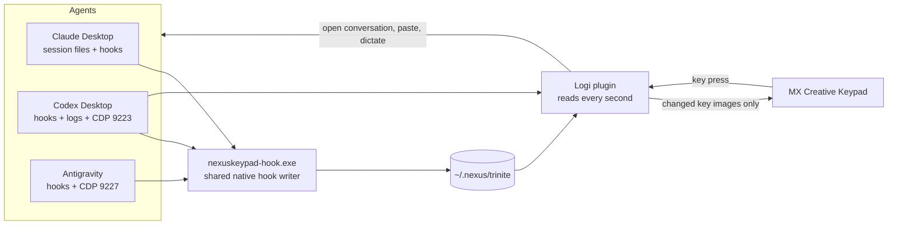

# NexusKeypad

[](https://github.com/pironjulien/NexusKeypad/actions/workflows/tests.yml)
[](https://github.com/pironjulien/NexusKeypad/blob/main/LICENSE)
[](https://github.com/pironjulien/NexusKeypad/blob/main/plugin/src/TrinitePadPlugin.csproj)
[](#requirements)

**Claude, Codex and Antigravity as animated pixel-art characters on the Logitech MX Creative Keypad.** A Logi Plugin
Service plugin that shows, at a glance, what each of your three AI coding agents is doing (working, waiting for you,
done, asleep), how much of their usage quota is left, and lets you jump to the conversation that needs you with one
key press.

<p align="center">
  
  
</p>

Rendered with the plugin's own drawing code (`apercu`, see [Development](#development)); on the device every key is
animated.

## Page 1: the agents

| | Codex | Claude | Antigravity |
|---|---|---|---|
| Row 1 | character | character | character |
| Row 2 | 5-hour and weekly quota left, open conversations | same | same |
| Row 3 | **Screen capture** | **Phone photo** (or clock) | **Dictation** |

- **Characters.** Each head is animated after the state of its most urgent conversation. Idle: it breathes, blinks and
  looks around. Working: Clawd (Claude's mascot) trots, Codex types code, Antigravity flies. A question for you: Clawd
  waves, Codex tilts its head while its terminal types "?", Antigravity sways under radar waves; a permission request
  adds a padlock. Done: Clawd's sunglasses, Codex's check mark and confetti, Antigravity's landing and fireworks.
  Error: crossed eyes and a red bolt. Usage limit reached: faded, heavy eyelids, empty battery. Dictation in its app:
  it listens. App closed: it sleeps ("z"); a press starts it and it wakes up.
- **Alerts.** A question blinks clearly, a finished turn breathes slowly, until you open that conversation.
- **One press** opens the conversation that blinks (full screen, scrolled to the last message), otherwise the app.
  App already in front: each press moves to the next conversation, urgent ones first, then most recent first.
- **Quota gauges** (no text): a clock gauge for the 5-hour window, a calendar gauge for the week, showing what is left
  (green when full, amber halfway, red when nearly empty), and the number of open conversations. A press opens the
  app's own usage panel; a second press closes it.
- **Screen capture** grabs the screen as you see it and pastes it, without sending, into the conversation of the agent
  in front (or of the last agent used). Images are reduced to WebP, at most 2000 px and 500 KB.
- **Phone photo**: with an Android phone reachable over adb (USB or wireless debugging), the latest photo or
  screenshot of the phone; a press pastes it into the agent in front. **Without a phone**, the key is an animated
  clock with the date; a press opens the Windows notification center and calendar.
- **Microphone** uses the control of the agent in front: Claude dictation, Codex dictation when available, or an
  Antigravity voice memo. A second press stops that recording. Codex's native voice chat is the fallback when its
  dictation control is unavailable; voice chat follows Codex's own conversation behavior and is not a promise of
  draft-only transcription. With no agent in front, the key opens Windows voice typing (Win+H).

## Page 2: the PC

| | | |
|---|---|---|
| Volume down (level in 10 steps) | Mute: waves that move with the sound | Volume up |
| Gmail: unread mails | Calendar: today's date and time | Messages: unread SMS/RCS |
| PC health: CPU and memory; opens Task Manager | Store and Windows Update: one press installs every available update | Website: your own link and logo |

- **Gmail, Calendar, Messages and the website** always open **in front**: their window if it is open, otherwise their
  Chrome-installed app (a Start menu or desktop shortcut with `--app-id`), otherwise a tabless Chrome app window
  (`--app=<url>`), otherwise the default browser.
- **A second press closes** the window the key opened (Gmail, Calendar, Messages, website, Task Manager, Codex quota),
  except when it fell back to your default browser (that window is not recognised and stays open).
- **Unread counts**: Gmail, from the title of its window or **tab** in Chrome (re-read every 3 s), otherwise from
  [NexusBrowser](https://github.com/pironjulien/NexusBrowser) when its "Gmail unread for the pad" box is ticked (works
  with Gmail closed); Messages, from its window or tab title, otherwise from the phone's pending notifications. No
  source, no badge.
- **Updates**: one press installs everything. There is no update API without admin rights, so Windows Update's Settings
  page opens on the left half of the screen and the Store's *Downloads and updates* page on the right half, both are
  searched, then their *Update all* / *Download & install all* button is pressed through UI Automation. Up to date, a
  window closes by itself; installing or unproven, it stays on screen. The pad never presses *Restart*; Windows may
  still restart on its own schedule, per its own settings. The key spins until both are done.
- **Task Manager on Performance**: set `"DefaultStartPage": 1` in
  `%LOCALAPPDATA%\Microsoft\Windows\TaskManager\settings.json` while Task Manager is closed.

The two bottom buttons of the keypad switch pages. A hidden page costs nothing: it is neither read nor drawn until the
keypad shows it.

### Website key

The bottom-right key opens a link of your choice. Create `%USERPROFILE%\.nexus\trinite\site.json`:

```json
{ "url": "https://example.org", "titre": "Example", "image": "logo.png", "anneau": ["#0055A4", "#FFFFFF", "#EF4135"] }
```

`image` is a PNG or JPEG (absolute, or relative to the JSON file), `anneau` the colors of the spinning ring, `titre`
how its window title starts (and the name of its app shortcut). Without `titre`, the key recognizes the window it
opened itself (a second press brings it back or closes it). Without this file, the key shows a spinning globe and
opens this repository. The file is read when the plugin loads.

## Better with the Nexus family, fine on its own

Every part of the Nexus family is optional. Install only the pad, or the whole family: each part adds to the others,
and when one is missing the pad falls back to something useful instead of an empty key.

| With | The pad gains | Without it |
|---|---|---|
| NexusKeypad connector (press its unplugged character to set up) | The AI's activity is connected to the pad, with setup and diagnostics under one name | The character offers setup; the app's existing data is not a verified full connection |
| Local app connection (prepared by the keypad) | Codex and Antigravity conversations, usage views and dictation controls | An already running app without the connection shows a restart arrow; no shortcut editing is needed |
| [NexusAndroid](https://github.com/pironjulien/NexusAndroid) (phone over adb) | The photo key pastes your phone's latest photo into the AI conversation; Messages badge from the phone | The photo key shows an animated clock and date (or your PC's latest screenshot); Messages counted from its open tab only |
| Nexus Relay (Claude, Codex and Antigravity talk to each other; not public yet) | Tiny messengers walk between Claude and Codex or Antigravity and give each other an electric shock while they work for Claude | Each agent works on its own; no runner |
| [NexusBrowser](https://github.com/pironjulien/NexusBrowser) (your real Chrome for AI agents) | Gmail unread count even with Gmail closed (read in your own Chrome session, only the number, stays on your PC) | Gmail counted only while it is open in a Chrome window or tab |
| [NexusWindows](https://julienpiron.fr/nexuswindows/) (desktop apps for AI agents) | Your agents also drive desktop apps in the background | The pad does not depend on it |
| Codex LB (local Codex load balancer) | Codex quota across all your accounts; a quota key that opens its dashboard | The official Codex app, quota read from its own logs, usage page in the browser |

## How it works



- **Claude**: the desktop app's session files (`%LOCALAPPDATA%\Claude-Data\…\claude-code-sessions`) plus the
  NexusKeypad plugin's hooks, which call the shared native `nexuskeypad-hook.exe` and write per-session activity
  under `~/.nexus/trinite/claude`. Quota: the plugin's usage module writes the 5-hour and weekly windows to
  `~/.nexus/trinite/quota-claude.json`; the desktop app's usage history and its visible Usage button provide fallback
  values. The displayed conversation identifies the account/organization, so quotas from different accounts are not mixed.
- **Codex**: native lifecycle hooks bundled in its NexusKeypad plugin, subject to Codex's own review and trust,
  plus `~/.codex/session_index.jsonl` and `~/.codex/sessions/**/rollout-*.jsonl` for history, asynchronous questions
  and fallback. Quota: the last `token_count` of its logs, or the `/api/usage/summary` of a local
  [codex-lb](https://github.com/Soju06/codex-lb) when one runs on port 2455. Conversations are opened through the
  app's debugging port 9223.
- **Antigravity**: its sidebar read through the debugging port 9227, plus its NexusKeypad plugin's hooks
  (`PreInvocation`, `PreToolUse`, `PostToolUse`, `Stop`). Quota: the visible *View Usage* panel is read without clicking;
  otherwise its own *Settings › Models* page is opened briefly at most every 15 minutes when idle conditions allow it.
  There is no call to its internal language server or reuse of its token.
- **Drawing**: pixel art computed from the clock, so a late frame still shows the right instant. Only key images that
  changed are sent to the Logi service (each one costs it more than drawing it): busy heads 8 frames per second, the
  rest 4 at most.

## Requirements

- Windows 11, a **Logitech MX Creative Console keypad** (MX Keypad) and **Logi Options+** with Logi Plugin Service 6.4
  or later.
- From source only: [.NET 10 SDK](https://dotnet.microsoft.com/download). The
  complete edition (one command, below) and the Marketplace editions need neither.
- Any of: **Claude Desktop** (Claude Code), **Codex** desktop app, **Antigravity**. A missing app just sleeps on its key.
  Claude's Code tab must have completed its first setup: the connector uses the official plugin manager bundled
  with that app. An unavailable plugin manager leaves setup pending instead of reporting a ready connection.
- Optional: an Android phone with USB or wireless debugging and `adb` on the `PATH` (photo key, Messages badge), and
  [NexusBrowser](https://github.com/pironjulien/NexusBrowser) (Gmail badge with Gmail closed). See the table above for
  what each one adds and what replaces it.

## Installation

### Complete edition (both pages, everything)

The complete **NexusKeypad** is everything described above, both pages, as the author runs it, with no administrator
rights. The simplest way is the **NexusSystem** app from the
[Microsoft Store](https://apps.microsoft.com/detail/9NSH2P3QLWT1) (or `winget install --id 9NSH2P3QLWT1 --source msstore`),
which installs and updates the Nexus products.

By hand: download `get.ps1` and `SHA256SUMS.txt` from the latest release, check the script, then run it as a file:

```powershell
$r = 'https://github.com/pironjulien/NexusKeypad/releases/latest/download'
Invoke-WebRequest "$r/get.ps1" -OutFile get.ps1
Invoke-WebRequest "$r/SHA256SUMS.txt" -OutFile SHA256SUMS.txt
(Get-FileHash get.ps1 -Algorithm SHA256).Hash   # must match the get.ps1 line of SHA256SUMS.txt
gh attestation verify get.ps1 --repo pironjulien/NexusKeypad   # optional: build provenance
powershell -NoProfile -ExecutionPolicy Bypass -File .\get.ps1
```

It downloads the latest release's `NexusKeypad` package (its hash is checked against the release's `SHA256SUMS.txt`
before extraction or execution), copies it
into Logi Options+'s plugin folder (`%LOCALAPPDATA%\Logi\LogiPluginService\Plugins\NexusKeypad`), where the Logi Plugin
Service loads it, and offers to place the 18 keys for you (your keypad profile is backed up first and Logi Options+
restarts for a few seconds; otherwise drag **Key 1** to **Key 18** of the *Trinity* group yourself). It then sets up the
connector of each AI app found (Claude, Codex, Antigravity); an unplugged character on the keypad sets one up again. Run
it again to update. To remove it (plugin, live states and keys; Logi Options+ is left alone), run the same verified file
with `-Remove`:

```powershell
powershell -NoProfile -ExecutionPolicy Bypass -File .\get.ps1 -Remove
```

**Updates.** The plugin never updates itself: `get.ps1`, run again by you, the NexusSystem app or an AI, installs
the latest release. The loaded version is in `~/.nexus/status/keypad.json` (read by the Nexus app).

**Usage journal.** The complete edition also keeps a local usage journal, one line per key press in
`%LOCALAPPDATA%\NexusJournal\keypad\<ai>\<YYYY-MM>.jsonl`: which key, which AI app it aimed at, how long it took,
whether it worked and a short fixed cause when it did not (`not opened`, `paste failed`…). It never holds a
conversation title, text or path, and never leaves your PC. Set `NEXUS_JOURNAL=0` to turn it off. The Marketplace
editions have no such journal.

It has its own plugin name, so Logi Options+ never mixes it up with a Marketplace edition: install one or the other.
The Marketplace editions below are the same code, split and trimmed to Logitech's rules (one function per plugin, no
default website).

### From the Logitech Marketplace (page 1 only)

The Marketplace edition, **AI Coding Agents**, is the agents page alone (the 9 keys above), without page 2 and without
the local test pipe. Install it from Logi Options+, then in Options+ open the keypad's profile and drag the actions
**Key 1** to **Key 9** of the *Trinity* group onto the 9 keys, in order (the plugin decides what each place shows).

Each AI has the same **NexusKeypad** connector and setup flow. A disconnected plug means setup is needed, a wrench
means repair, and crossed eyes mean an error. Each character keeps its own face and style.
Press it and approve setup to install or repair only that AI's
connector while preserving other settings. Dialogs use English; no text covers the Relay mini characters.

A small arrow inside the character indicates an open app without its local keypad connection. Only this situation
can offer a separate restart, with consent and without forcing an app to close. Work, questions, permissions and
dictation prevent it. Installing a connector never requires an already connected Codex or Antigravity to restart.
Claude's character stays ready at idle; the diagnostic separately records whether its first real activity event has
been observed since setup. Codex's bundled hooks require Codex's own review and trust; its existing log reader keeps
activity tracking available while review is pending.
Hidden app windows reopen normally. Ordinary presses remain available with a partial connection and do not repeat
the restart prompt.

The normal character returns after configuration and the available running-app connection have been checked;
real conversation states always take priority. This does not by itself prove microphone access or an authenticated account. The **Live states** action in the
*Trinity* group provides a separate NexusKeypad enable/disable command for each AI.

One engine runs in Logitech Options+. The three connectors package each host's settings and diagnostics; they do
not add three engines or MCP servers. The keypad prepares the required local app launch options automatically.

Package it yourself with `pwsh -File outils\paquet_marketplace.ps1` (builds the Marketplace edition, packs it and
checks it with the official Logi Plugin Tool). License terms: [EULA](https://github.com/pironjulien/NexusKeypad/blob/main/EULA.md);
data: [Privacy Policy](https://github.com/pironjulien/NexusKeypad/blob/main/PRIVACY.md).

### From the Logitech Marketplace: PC Dashboard (page 2 only)

The second Marketplace plugin, **PC Dashboard**, is page 2 alone (volume, mute, Gmail, Calendar, Messages, PC health,
Store and Windows Update, a website key), without the agents. Install it from Logi Options+, then drag **Key 1** to
**Key 8** of the *PC Dashboard* group onto the keys, in order, and **Website** onto the last one: type the address it
opens in its settings (no website is set by default; you can add several Website keys, each with its own address).
Gmail and Messages badges come from their Chrome windows or tabs, then from an Android phone over adb if any.

Package it yourself with `pwsh -File outils\paquet_marketplace.ps1 -Edition Poste`. License terms:
[EULA](https://github.com/pironjulien/NexusKeypad/blob/main/EULA-PC-DASHBOARD.md); data:
[Privacy Policy](https://github.com/pironjulien/NexusKeypad/blob/main/PRIVACY-PC-DASHBOARD.md).

### From the Logitech Marketplace: AI Coding Agents + PC (both pages)

**AI Coding Agents + PC** is both pages in one plugin, like the source build below without the local test pipe:
install it instead of the two plugins above, then drag **Key 1** to **Key 9** of the *Trinity* group onto page 1 and
**Key 10** to **Key 17** onto page 2, and **Website** onto the last key: type the address it opens in its settings, as
in PC Dashboard (no website is set by default). Package it yourself with
`pwsh -File outils\paquet_marketplace.ps1 -Edition Complete`. Terms:
[EULA](https://github.com/pironjulien/NexusKeypad/blob/main/EULA-AI-AGENTS-PC.md); data:
[Privacy Policy](https://github.com/pironjulien/NexusKeypad/blob/main/PRIVACY-AI-AGENTS-PC.md).

### Packages from a GitHub release

Each [release](https://github.com/pironjulien/NexusKeypad/releases) carries the three packages (`.lplug4`), built by
GitHub Actions from `main` (first published as a development pre-release `vX.Y.Z-dev.N`, then promoted unchanged to the
stable `vX.Y.Z`), with `SHA256SUMS.txt` and a build provenance attestation
(`gh attestation verify <file> --repo pironjulien/NexusKeypad`). Logi Options+ does not install a package opened
from a file (double-clicking it does nothing): install from the Marketplace when you can. Developers can install a
package with the official Logi Plugin Tool (`dotnet tool install -g LogiPluginTool`, then
`logiplugintool install <file>`).

### From source (both pages)

```powershell
git clone https://github.com/pironjulien/NexusKeypad
cd NexusKeypad
dotnet build -c Debug plugin\src -p:Edition=Nexus -p:Reel=true   # builds outside OneDrive and installs NexusKeypad
```

Press the unplugged character on each AI key to install its connector. No separate hook-installation command is needed.

Then place the 18 keys on the keypad's default profile with the plugin's own helper (the same one get.ps1 uses), with
the Logi service stopped, after backing up `ProfileInfo.json` (copy the backup back to restore it), and restart the Logi
Options+ agent:

```powershell
$app = "$env:LOCALAPPDATA\Logi\LogiPluginService\Applications\Loupedeck70\@_defaultwin"
$profil = "$app\Profiles\$((Get-Content "$app\ApplicationInfo.json" -Raw | ConvertFrom-Json).defaultProfileName)\ProfileInfo.json"
Copy-Item $profil (Join-Path (Split-Path $profil) 'ProfileInfo.before-nexuskeypad.json')
& "$env:LOCALAPPDATA\Logi\LogiPluginService\Plugins\NexusKeypad\bin\nexuskeypad-hook.exe" keys $profil NexusKeypad
pwsh -File outils\relancer_logi.ps1
```

**Debugging ports.** Opening a Codex or Antigravity conversation and dictating into them go through their Chromium
debugging port, on `127.0.0.1` only:

- Codex and Antigravity: the keypad starts the official app with its local connection (9223 and 9227 respectively).
  An app already open without it shows a restart arrow. Use its key to finish setup; no shortcut needs to be edited.

Anything listening on these ports can drive the app: do not enable them on a shared PC.

## Privacy

NexusKeypad has no analytics or data-collection server. Its activity files, connector receipts and cached images stay
on the PC. Local app connections use `127.0.0.1`; an attached phone uses adb over USB or the local network. The complete
edition contacts GitHub only when `get.ps1` installs or updates it. An app or browser opened by a key connects to
its own service under that app's privacy policy. See the [Privacy Policy](PRIVACY.md) for the detailed local files.

- **Read**: the agents' local session files and logs, their windows (UI Automation) and pages (debugging ports), the
  Windows audio, CPU and memory state; with a phone, its latest photo and its notification list over adb; the site
  key setting `~/.nexus/trinite/site.json` (and its image); the phone's Wi-Fi pairing note
  `~/.nexus/nexus-android/wifi.json`; when the website key has no `titre`, at each press, the page addresses of Chrome
  app windows (UI Automation), to find the window it opened (neither kept nor logged).
- **Written**: `~/.nexus/trinite` holds hook states, bounded captures/photos and Codex callback diagnostics. The shared
  helper, connector packages, activation receipts and quota cache live in `%LOCALAPPDATA%\NexusKeypad`. After setup
  approval, each AI has a NexusKeypad plugin with its skill and hooks: Claude's local marketplace/settings, Codex's
  local plugin/cache/catalogue and activation setting, or Antigravity's plugin directory and activation setting.
  Other plugins and settings are preserved. Logi keeps a local plugin log; its name depends on the installed edition.
- **Clipboard**: Screen capture and Photo put the image in the clipboard and paste it; the keypad does not press Send.
  Codex voice chat, when used as the microphone fallback, follows Codex's own voice behavior.
- **Remove the complete edition**: run the downloaded official installer as `pwsh -File .\get.ps1 -Remove`. It
  disconnects the NexusKeypad integrations it installed, removes the Logi plugin and its assigned keys, and preserves
  the profile backup. Connector caches, quota files and captured images may remain; after disconnection, remove
  `%LOCALAPPDATA%\NexusKeypad` and `~/.nexus/trinite` if you no longer need them. For a Marketplace edition, disconnect
  its AI integrations first with that edition's per-AI NexusKeypad actions, then uninstall it in Logi Options+.

## Limitations

- Built and tested on one setup (Windows 11 in French, MX Creative Keypad). The plugin finds some buttons by their
  label, in **French or English** for Claude (dictation, usage button and its quota fallback) and Codex (voice chat,
  dictation), English for Antigravity, taken from the apps' own language files. With another app language these
  presses do nothing; the states, alerts, Codex and Antigravity quotas, capture and page 2 do not depend on it.
- The agents' apps change often; a new version can move a button the plugin relies on.
- The keypad turns off with the PC screen (Windows powers its display down); the plugin stops drawing meanwhile.
- Code comments and identifiers are in French.

## Development

```powershell
pwsh -File test.ps1
```

Requires Node.js for the isolated JavaScript UI tests (no npm dependencies). The installed keypad does not need Node.js.
Builds the plugin's editions aside (no install, no reload), then runs `dotnet test` from the repository root (xUnit v3 on
Microsoft.Testing.Platform, selected by `global.json`): the logic rules and every key drawn in every situation
(`tests/Logique`, with `apercu`), the connectors (`tests/Connecteurs`), the launchers (`tests/Isole`) and the native hook
(`tests/Hook`), without touching the installed plugin. The CI runs the same `test.ps1`. Without the Logi service (CI), the
build uses the [LogiPluginApi](https://www.nuget.org/packages/LogiPluginApi) package. Checks on the real PC (clipboard,
live apps) are explicit tests, run only on request: `dotnet test --project tests/Logique -- --explicit only`.

- `dotnet run --project apercu -- <folder> [photo.jpg]` draws PNG boards of all keys with the real rendering code.
- `pwsh -File outils\pad.ps1 capture|snapshot|etat|--reel appui <1-18>` talks to the running plugin through a local pipe
  reserved to the current user: the 9 keys as sent to the keypad, the cached state, a simulated press (`--reel` only).

## License

[MIT](https://github.com/pironjulien/NexusKeypad/blob/main/LICENSE), with an
[EULA](https://github.com/pironjulien/NexusKeypad/blob/main/EULA.md) and a
[Privacy Policy](https://github.com/pironjulien/NexusKeypad/blob/main/PRIVACY.md) for the Marketplace edition
(no data collected), and their [EULA](https://github.com/pironjulien/NexusKeypad/blob/main/EULA-PC-DASHBOARD.md)
and [Privacy Policy](https://github.com/pironjulien/NexusKeypad/blob/main/PRIVACY-PC-DASHBOARD.md) for PC
Dashboard. Claude, Codex, Antigravity, Gmail, Logitech
and MX are trademarks of their owners; this project is not affiliated with them.
