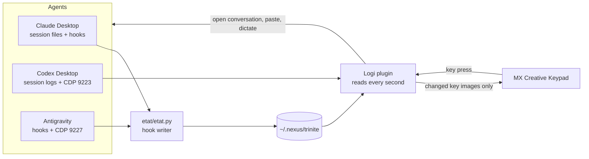

# MX Keypad AI Agents

[](https://github.com/pironjulien/mx-keypad-ai-agents/actions/workflows/tests.yml)
[](https://scorecard.dev/viewer/?uri=github.com/pironjulien/mx-keypad-ai-agents)
[](https://github.com/pironjulien/mx-keypad-ai-agents/blob/main/LICENSE)
[](https://github.com/pironjulien/mx-keypad-ai-agents/blob/main/plugin/src/TrinitePadPlugin.csproj)
[](#requirements)

**Claude, Codex and Antigravity as animated pixel-art characters on the Logitech MX Creative Keypad.** A Logi Plugin
Service plugin that shows, at a glance, what each of your three AI coding agents is doing (working, waiting for you,
done, asleep), how much of their usage quota is left, and lets you jump to the conversation that needs you with one
key press.

<p align="center">
  
  
</p>

Rendered with the plugin's own drawing code (`apercu`, see [Development](#development)); on the device every key is
animated.

## Page 1: the agents

| | Codex | Claude | Antigravity |
|---|---|---|---|
| Row 1 | character | character | character |
| Row 2 | 5-hour and weekly quota left, open conversations | same | same |
| Row 3 | **Screen capture** | **Phone photo** (or clock) | **Dictation** |

- **Characters.** Each head is animated after the state of its most urgent conversation. Idle: it breathes, blinks and
  looks around. Working: Clawd (Claude's mascot) trots, Codex types code, Antigravity flies. Waiting for you: Clawd
  waves, the other two show a "?". Done: sunglasses or sparkles. App closed: it sleeps ("z"), a press starts it.
- **Alerts.** A question blinks clearly, a finished turn breathes slowly, until you open that conversation.
- **One press** opens the conversation that blinks (full screen, scrolled to the last message), otherwise the app.
  App already in front: each press moves to the next conversation, urgent ones first, then most recent first.
- **Quota gauges** (no text): a clock gauge for the 5-hour window, a calendar gauge for the week, showing what is left
  (green when full, amber halfway, red when nearly empty), and the number of open conversations. A press opens the
  app's own usage panel; a second press closes it.
- **Screen capture** grabs the screen as you see it and pastes it, without sending, into the conversation of the agent
  in front (or of the last agent used). Images are reduced to WebP, at most 1568 px and 500 KB.
- **Phone photo**: with an Android phone reachable over adb (USB or wireless debugging), the latest photo or
  screenshot of the phone; a press pastes it into the agent in front. **Without a phone**, the key is an animated
  clock with the date; a press opens the Windows notification center and calendar.
- **Dictation** starts the dictation button of the agent in front (Claude, Codex voice, Antigravity voice memo); a
  second press stops it and leaves the text in the field, unsent. No agent in front: Windows voice typing (Win+H).

## Page 2: the PC

| | | |
|---|---|---|
| Volume down (level in 10 steps) | Mute: waves that move with the sound | Volume up |
| Gmail: unread mails | Calendar: today's date and time | Messages: unread SMS/RCS |
| PC health: CPU and memory; opens Task Manager | Store and Windows Update: one press installs every available update | Website: your own link and logo |

- **Gmail, Calendar, Messages and the website** always open **in front**: their window if it is open, otherwise their
  Chrome-installed app (a Start menu or desktop shortcut with `--app-id`), otherwise a tabless Chrome app window
  (`--app=<url>`), otherwise the default browser.
- **A second press closes** the window the key opened (Gmail, Calendar, Messages, website, Task Manager, Codex quota).
- **Unread counts**: Gmail, from the title of its window or **tab** in Chrome (re-read every 3 s), otherwise from
  [NexusBrowser](https://github.com/pironjulien/NexusBrowser) when its "Gmail unread for the pad" box is ticked (works
  with Gmail closed); Messages, from its window or tab title, otherwise from the phone's pending notifications. No
  source, no badge.
- **Updates**: one press installs everything, without bringing anything to the front. There is no update API without
  admin rights, so the Store's *Downloads and updates* page and Windows Update's Settings page are shown behind your
  windows (minimized, they expose no buttons), searched, then their *Update all* / *Download & install all* button is
  pressed through UI Automation, and they are minimized again. Never a restart. The key spins until both are done.
- **Task Manager on Performance**: set `"DefaultStartPage": 1` in
  `%LOCALAPPDATA%\Microsoft\Windows\TaskManager\settings.json` while Task Manager is closed.

The two bottom buttons of the keypad switch pages. A hidden page costs nothing: it is neither read nor drawn until the
keypad shows it.

### Website key

The bottom-right key opens a link of your choice. Create `%USERPROFILE%\.nexus\trinite\site.json`:

```json
{ "url": "https://example.org", "titre": "Example", "image": "logo.png", "anneau": ["#0055A4", "#FFFFFF", "#EF4135"] }
```

`image` is a PNG or JPEG (absolute, or relative to the JSON file), `anneau` the colors of the spinning ring, `titre` a
word of its window title (and the name of its app shortcut), by default the site's host name. Without
this file, the key shows a spinning globe and opens this repository. The file is read when the plugin loads.

## Better with the Nexus family, fine on its own

Every part of the Nexus family is optional. Install only the pad, or the whole family: each part adds to the others,
and when one is missing the pad falls back to something useful instead of an empty key.

| With | The pad gains | Without it |
|---|---|---|
| [NexusAndroid](https://github.com/pironjulien/NexusAndroid) (phone over adb) | The photo key pastes your phone's latest photo into the AI conversation; Messages badge from the phone | The photo key shows an animated clock and date (or your PC's latest screenshot); Messages counted from its open tab only |
| Nexus Relay (Claude, Codex and Antigravity talk to each other; not public yet) | A tiny Clawd runs from Claude to Codex or Antigravity while they work for Claude | Each agent works on its own; no runner |
| [NexusBrowser](https://github.com/pironjulien/NexusBrowser) (your real Chrome for AI agents) | Gmail unread count even with Gmail closed (read in your own Chrome session, only the number, stays on your PC) | Gmail counted only while it is open in a Chrome window or tab |
| [NexusWindows](https://julienpiron.fr/nexuswindows/) (desktop apps for AI agents) | Your agents also drive desktop apps in the background | The pad does not depend on it |
| Codex LB (local Codex load balancer) | Codex quota across all your accounts; a quota key that opens its dashboard | The official Codex app, quota read from its own logs, usage page in the browser |

## How it works



- **Claude**: the desktop app's session files (`%LOCALAPPDATA%\Claude-Data\…\claude-code-sessions`) plus Claude Code
  hooks that run `etat/etat.py` (state per session in `~/.nexus/trinite/claude`). Quota: the name of the app's
  "Usage" button, never expanded by the plugin.
- **Codex**: `~/.codex/session_index.jsonl` and `~/.codex/sessions/**/rollout-*.jsonl` (task started, task complete,
  approval requests). Quota: the last `token_count` of its logs, or the `/api/usage/summary` of a local
  [codex-lb](https://github.com/Soju06/codex-lb) when one runs on port 2455. Conversations are opened through the
  app's debugging port 9223.
- **Antigravity**: its sidebar read through the debugging port 9227, plus its hooks (`PreInvocation`, `PreToolUse`,
  `PostToolUse`, `Stop`). Quota: its own *Settings › Models* page, read on screen like a person would (only when you
  have been idle for a while, at most every 15 minutes); no call to its internal language server or token.
- **Drawing**: pixel art computed from the clock, so a late frame still shows the right instant. Only key images that
  changed are sent to the Logi service (each one costs it more than drawing it): busy heads 8 frames per second, the
  rest 4 at most.

## Requirements

- Windows 11, a **Logitech MX Creative Console keypad** (MX Keypad) and **Logi Options+** with Logi Plugin Service 6.4
  or later.
- [.NET 10 SDK](https://dotnet.microsoft.com/download) and Python 3.11+ (hook writer and setup scripts).
- Any of: **Claude Desktop** (Claude Code), **Codex** desktop app, **Antigravity**. A missing app just sleeps on its key.
- Optional: an Android phone with USB or wireless debugging and `adb` on the `PATH` (photo key, Messages badge), and
  [NexusBrowser](https://github.com/pironjulien/NexusBrowser) (Gmail badge with Gmail closed). See the table above for
  what each one adds and what replaces it.

## Installation

```powershell
git clone https://github.com/pironjulien/mx-keypad-ai-agents
cd mx-keypad-ai-agents
dotnet build -c Debug plugin\src        # builds to %LOCALAPPDATA%\NexusKeypad and installs the plugin package
python -I outils\installer_hooks.py $env:USERPROFILE\.claude\settings.json   # Claude and Antigravity hooks
```

Then place the 18 keys on the keypad's default profile, with the Logi service stopped (the script backs up
`ProfileInfo.json`; `--retour` restores it), and restart the Logi Options+ agent:

```powershell
python -I outils\placer_touches.py
pwsh -File outils\relancer_logi.ps1
```

**Debugging ports.** Opening a Codex or Antigravity conversation and dictating into them go through their Chromium
debugging port, on `127.0.0.1` only:

- Codex: when the plugin starts Codex (its head key, app closed), it passes `--remote-debugging-port=9223`. If you start
  Codex yourself, quit it once and start it from the keypad.
- Antigravity: add `--remote-debugging-port=9227` to the target of its Start menu shortcut.

Anything listening on these ports can drive the app: do not enable them on a shared PC.

## Privacy

Everything stays on the PC. The plugin makes no network request except to `127.0.0.1` (debugging ports, and codex-lb
when present) and, on a key press, to the page you asked for.

- **Read**: the agents' local session files and logs, their windows (UI Automation) and pages (debugging ports), the
  Windows audio, CPU and memory state; with a phone, its latest photo and its notification list over adb; the site
  key setting `~/.nexus/trinite/site.json` (and its image); the phone's Wi-Fi pairing note
  `~/.nexus/nexus-android/wifi.json`.
- **Written**: `~/.nexus/trinite` (hook states, the last 5 screen captures, the last 5 phone photos and their reduced
  copies), the plugin log in `%LOCALAPPDATA%\Logi\LogiPluginService\Logs\plugin_logs\TrinitePad.log`, build output and the last
  Antigravity quota read (`quota-antigravity.json`) in `%LOCALAPPDATA%\NexusKeypad`.
- **Clipboard**: Screen capture and Photo put the image in the clipboard before pasting it; nothing is ever sent.
- **Remove everything**: `python -I outils\placer_touches.py --retour`, delete
  `%LOCALAPPDATA%\Logi\LogiPluginService\Plugins\TrinitePad`, `%LOCALAPPDATA%\NexusKeypad` and `~/.nexus/trinite`, and
  remove the hooks that call `etat\etat.py` from `~/.claude/settings.json` and the `trinite-pad` entry of
  `~/.gemini/config/hooks.json`.

## Limitations

- Built and tested on one setup (Windows 11 in French, MX Creative Keypad). The plugin finds some buttons by their
  label, and those labels are the **French** ones for Claude (dictation, "Utilisation" usage button and its quota
  fallback) and Codex (voice chat, dictation); Antigravity's are English. With another app language these presses do
  nothing; the states, alerts, Codex and Antigravity quotas, capture and page 2 do not depend on it.
- The agents' apps change often; a new version can move a button the plugin relies on.
- The keypad turns off with the PC screen (Windows powers its display down); the plugin stops drawing meanwhile.
- Code comments and identifiers are in French.

## Development

```powershell
pwsh -File test.ps1
```

Builds the plugin aside (no install, no reload), draws every key in every situation (`apercu`), checks the logic rules
(`verifier`) and the hook rules (`tests`), without touching the installed plugin. Without the Logi service (CI), the
build uses the [LogiPluginApi](https://www.nuget.org/packages/LogiPluginApi) package.

- `dotnet run --project apercu -- <folder> [photo.jpg]` draws PNG boards of all keys with the real rendering code.
- `python -I outils\pad.py capture|appui <1-18>|etat` talks to the running plugin through a local pipe reserved to
  the current user: the 9 keys as sent to the keypad, a simulated press, the last state read.

## License

[MIT](https://github.com/pironjulien/mx-keypad-ai-agents/blob/main/LICENSE). Claude, Codex, Antigravity, Gmail, Logitech
and MX are trademarks of their owners; this project is not affiliated with them.
